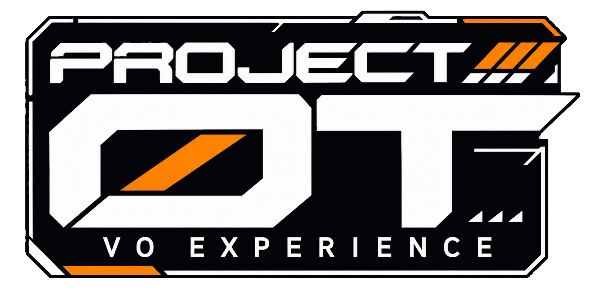
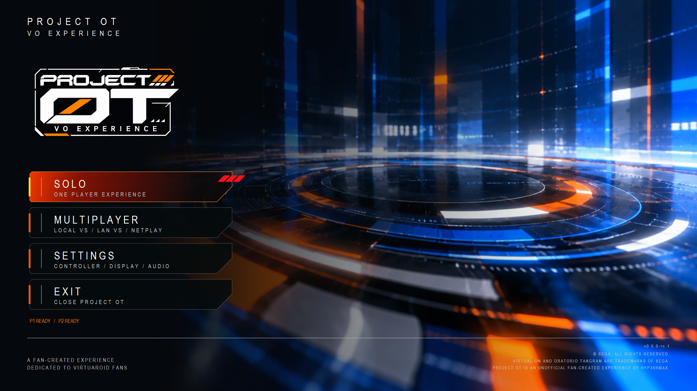
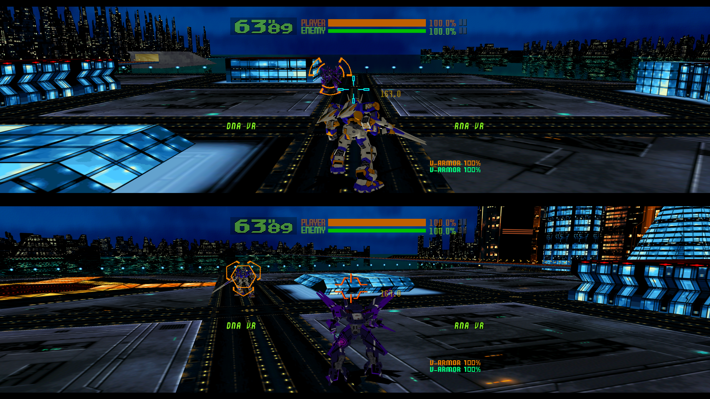

<!-- POT-MEDIA03:branding -->

<!-- /POT-MEDIA03:branding -->

# PROJECT OT
### Virtual On Experience

**The original Virtual-On: Oratorio Tangram M.S.B.S. Ver. 5.66 arcade experience, brought to modern Windows PCs.**

PROJECT OT preserves the original SEGA NAOMI gameplay while bringing modern controller support, expanded displays, linked multiplayer and an improved player experience to Windows.

Built around the original arcade release, the goal is to make *Oratorio Tangram* more accessible without changing what made it special.

## Release candidate status

`v0.5.0-rc.1` is available as a [public Release Candidate](https://github.com/hyp36rmax/project-ot/releases/tag/v0.5.0-rc.1). Matching corrected runtime source is also public. Physical RC acceptance and the Experience source-scope and installation review remain open. See [release readiness](docs/release-guide.md) and [known issues](docs/known-issues.md).

[Full RC release notes](RELEASE-NOTES-v0.5.0-rc.1.md) describe the published candidate and remaining qualification and licensing limits.

## Features

### Original Arcade Experience

Experience authentic NAOMI 5.66 gameplay, preserving the original movement, weapons, combat mechanics and linked competition.

### Modern Gamepads & Arcade Twin-Sticks

Play with modern dual analog gamepads or compatible arcade Twin-Stick hardware.

**Controller layouts and profiles**

| Gamepads | Arcade Twin-Sticks |
|---|---|
| Xbox controllers | HORI Twin Stick EX |
| PlayStation controllers via compatible XInput | Tanita Twin-Stick |
| Other compatible dual analog XInput gamepads | Custom Brook / XInput Twin-Sticks |
| | Dreamcast Twin-Sticks via Raphnet |
| | Saturn Twin-Sticks via Raphnet |

Mix compatible controllers in Local VS. One player can use a gamepad while the other uses Twin-Sticks, or both can use their preferred setup.

Controller assignment, button mapping, analog calibration and input testing are managed directly within PROJECT OT.

The table lists available layouts and profiles, not certification of every controller or adapter revision. Check the guide for setup and qualification limits.

[Controller Setup](docs/controllers.md)

### Local VS: One PC, Two Players

Bring the original linked cabinet competition to a single Windows PC.

**Single Display**

Both players share one monitor, with independent gameplay views and controllers.

**Dual Display VS**

Each player receives a dedicated physical display, with independent controls, game views and supported display configurations.

Play together on one ultrawide monitor or recreate the original two cabinet experience with separate screens.

[Local VS Guide](docs/local-vs.md)

### Arcade Cabinet Mode

Bring the original twin-cabinet arcade experience to modern PC hardware.

Arcade Cabinet Mode supports two persistent NAOMI cabinet environments, each with its own gameplay presentation and independent player controls.

Designed for dedicated arcade setups, it brings the authentic linked-cabinet experience together under PROJECT OT, extending beyond standard Local VS.

### LAN VS: Local Network Multiplayer

Connect PROJECT OT stations across your local network.

The Match Board lets players discover available stations, challenge opponents, accept matches and confirm readiness. Direct Connect provides an alternative when automatic discovery is unavailable.

**Wired Ethernet is recommended.** Wi-Fi is also supported, although station discovery can vary depending on Windows, wireless adapter capabilities and router settings.

Sustained cross-PC gameplay remains under qualification. A reported `NETWORK ERROR` / `0xB002` is unresolved; this RC does not claim a networking fix.

[LAN VS Guide](docs/lan-vs.md)

### Modern Displays

Enjoy the original arcade presentation or expand the horizontal field of view with Hor+ rendering.

| Aspect Ratio | Presentation |
|---|---|
| 4:3 | Original Arcade |
| 16:9 | Widescreen |
| 21:9 | Ultrawide |
| 32:9 | Super Ultrawide |

Rendering quality includes Original 480p, Performance 720p, High 1080p, Ultra 1440p and 4K 2160p.

Our dedicated runtime introduces improvements to rendering, projection and object visibility, allowing the original game world to expand horizontally rather than stretching the original 4:3 picture.

[Display Settings](docs/display.md)

### Unified Experience

PROJECT OT brings the original NAOMI 5.66 arcade game to modern Windows PCs through our dedicated runtime and Experience framework.

Controller configuration, display settings, audio controls, Solo, Local VS and LAN VS are brought together in one application, preserving the original gameplay while improving how players experience it.

## Getting Started

### Requirements

A Windows x64 PC, compatible gamepad or Twin-Sticks, and your legally obtained *Virtual-On: Oratorio Tangram M.S.B.S. Ver. 5.66* game and required SEGA NAOMI firmware.

### Microsoft Prerequisites

| Software | Official Download |
|---|---|
| Microsoft .NET 10 Runtime x64 | [Microsoft .NET 10](https://dotnet.microsoft.com/en-us/download/dotnet/10.0) |
| Microsoft Visual C++ Redistributable x64 | [Microsoft VC++ Runtime](https://aka.ms/vc14/vc_redist.x64.exe) |

The current candidate uses external .NET 10 Runtime x64 and Visual C++ v14 x64. The native Experience does not require the .NET SDK or Desktop Runtime. See [installation and prerequisites](docs/getting-started.md#microsoft-prerequisites) for the checked baseline.

### Pick Up & Play

1. Download PROJECT OT from the [v0.5.0-rc.1 release](https://github.com/hyp36rmax/project-ot/releases/tag/v0.5.0-rc.1).
2. Extract the complete ZIP into a new folder and follow its instructions.
3. Put your legally obtained compatible `vonot.zip` and `naomi.zip` in the root `data/` folder.
4. Launch `ProjectOT.exe`.
5. Follow the on-screen controller claim instructions, check settings and choose your game mode.

[Pick Up & Play Guide](docs/getting-started.md)

## Screenshots & Gameplay

User-supplied captures of the Project OT Experience. Screenshots illustrate the interface and captured gameplay; they do not establish additional hardware acceptance or sustained LAN reliability.

**Title Menu** — the Project OT entry point.

**Local VS** — linked two-player gameplay, with P1 above P2 in this capture.

**Multiplayer** — navigation to local and linked play. Internet NETPLAY VS remains unavailable.

See the [player guides](docs/README.md) for Settings, Link Play and Match Board captures.

## Frequently Asked Questions

### What is PROJECT OT?

An unofficial fan created Windows experience for the original SEGA NAOMI release of *Virtual-On: Oratorio Tangram M.S.B.S. Ver. 5.66*.

### Is PROJECT OT a remake?

No. PROJECT OT runs the original NAOMI arcade software through our dedicated runtime while improving the surrounding player experience.

### Can I use arcade Twin-Sticks?

Profiles are available for HORI, Tanita, Custom/Brook and the listed Raphnet adapters. Physical coverage varies by device and revision; use [Controller Setup](docs/controllers.md) and Test Controls before play.

### Can two players share one PC?

Yes. Local VS supports two players using either a single display or two independent physical monitors.

### Can I use different controllers for each player?

Yes. Local VS allows compatible gamepads and Twin-Sticks to be mixed, with independent player assignments.

### What is Arcade Cabinet Mode?

Arcade Cabinet Mode provides two persistent NAOMI cabinet environments for dedicated arcade setups, with independent player controls and displays. Unlike standard Local VS, it is designed around the operation of two arcade cabinets within one PROJECT OT experience.

### Does PROJECT OT support widescreen and ultrawide monitors?

Yes. PROJECT OT supports original 4:3 presentation and expanded 16:9, 21:9 and 32:9 rendering in supported configurations.

### Can I play over Wi-Fi?

Ethernet and Wi-Fi discovery paths are implemented. Wired Ethernet is recommended, but sustained cross-PC reliability remains unqualified for this RC. See the [LAN guide](docs/lan-vs.md) and [known issues](docs/known-issues.md#lan-vs).

### Does PROJECT OT include the original game?

No. Players must provide their own legally obtained game and required firmware.

### Is PROJECT OT open source?

The corrected Flycast-derived runtime source is public; see [Runtime Source & Licensing](#runtime-source--licensing). The C# Experience source remains private. Its source-scope and installation obligations, and proposed recipient terms, remain under review; repository separation does not settle that boundary.

## Runtime Source & Licensing

The [matching corrected Flycast runtime source release](https://github.com/hyp36rmax/flycast-lean-voot/releases/tag/source-v0.5.0-rc.1-corrected) contains both Solo/Local and LAN variants, dependency source, build materials, copyright and license notices, and hosted protocol documentation. Download the attached `Flycast-Lean-VOOT-v0.5.0-rc.1-Corrected-Source.zip` and [checksums](https://github.com/hyp36rmax/flycast-lean-voot/releases/download/source-v0.5.0-rc.1-corrected/SHA256SUMS.txt).

| Component | SHA-256 |
| --- | --- |
| Solo/Local runtime | `43DEE4CF0CBEC6AA731D33C765C06F8B1C29AB32BB6E75B06225E1A26FE4A022` |
| LAN runtime | `6AE1C948213BB0A501A6192CE2082FED7804DCB198886B264E24768A47EDA713` |
| Source bundle | `AFB826268100CEAF898A53B5BFD64314C0765778EA2065C698ECAAA0ADDF495F` |

Anonymous source retrieval and checksums were verified. Independent bit-for-bit build reproducibility has not been established. The runtime and dependencies retain their applicable licenses; this documentation adds no proprietary restrictions to them. Public native-runtime source delivery does not resolve the Experience source-scope or installation obligations, approve its proposed recipient terms, or establish full compliance clearance. See [legal notes](LEGAL.md).

## Behind PROJECT OT

PROJECT OT began with a simple goal: preserve the original arcade experience while improving how we enjoy it on modern hardware.

From modern Twin-Stick support and expanded displays to bringing linked NAOMI cabinets together, each improvement has been part of a larger effort to keep the original game accessible.

[Read Our Story](docs/development-history.md)

## Known limitations in this candidate

- Physical RC gameplay, display and controller combinations still need acceptance.
- Cross-PC `0xB002` and sustained LAN reliability remain unresolved.
- Higher-resolution damage-flash checks and the Local VS Windows firewall-dialog trigger remain open.
- Internet Netplay, rollback, spectators and gameplay-triggered rumble are not offered features.

Read [Known Issues](docs/known-issues.md) before testing. [F12 Feedback & Diagnostics](docs/feedback.md) records a local report; it does not upload anything automatically.

## Downloads & Support

[Downloads & Releases](https://github.com/hyp36rmax/project-ot/releases) | [Pick Up & Play](docs/getting-started.md) | [Compatible Controllers](docs/controllers.md) | [Known Issues](docs/known-issues.md) | [Report a Problem](https://github.com/hyp36rmax/project-ot/issues) | [Credits](CREDITS.md)

**The public RC is available. Physical qualification and the Experience licensing review remain open.**

---

PROJECT OT is an unofficial fan project, not affiliated with or endorsed by SEGA. Original game content and trademarks belong to their respective owners. Commercial game ROMs and proprietary NAOMI BIOS files are not included.

**Preserve the game. Improve the experience.**
