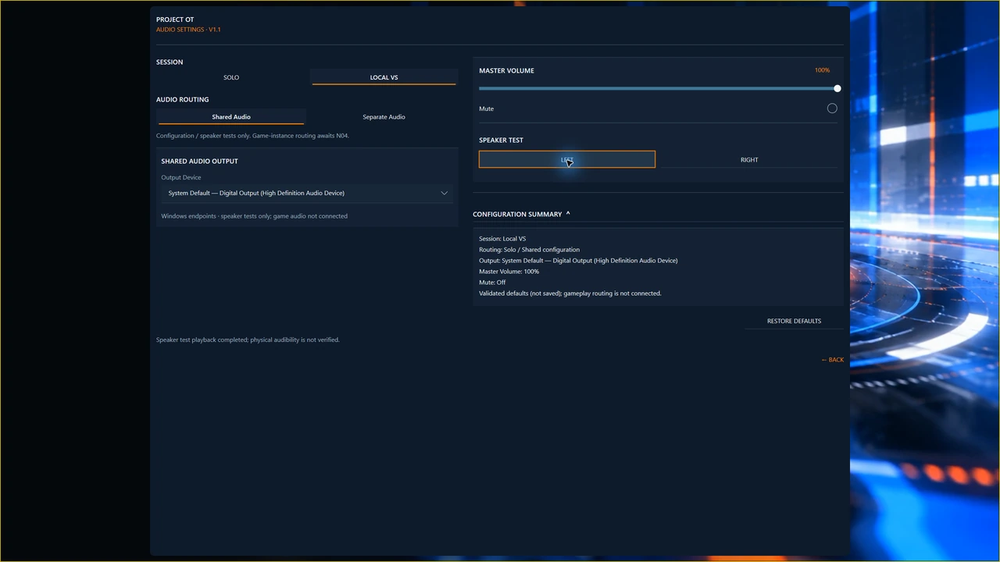

# Audio output, volume and speaker tests

Open **Settings → Audio** and choose Solo or Local VS. Start at a comfortable listening level before testing speakers.

## Choose an output and level

**System Default** follows the Windows default output for configuration and tests. A named output selects that device for the test path. Use **Master Volume** and **Mute** for the selected session's preferences; these do not change Windows system master volume.

With a controller, Confirm enters volume editing, Up/Down adjusts the level, and Confirm or Back finishes editing. Mouse and keyboard adjustment are also available.

**Current live-routing limit:** endpoint choices and Shared/Separate preferences configure settings and tests; they do not route live game audio. Existing gameplay uses the build's established output path. Applying this page's volume/mute settings to gameplay still needs end-to-end checking.

## Speaker Test

Choose an enabled left or right test and listen for the expected physical speaker. The chime is separate from gameplay sound and can run without a game. A test-only mute bypass does not unmute the game or Windows. Report test silence separately from gameplay silence.

<!-- POT-MEDIA03:speaker -->

*Speaker-test interface after invocation. Physical audibility was not independently verified; live game audio routing is not demonstrated.*
<!-- /POT-MEDIA03:speaker -->

## Local VS and saved settings

**Shared Audio** has common output/volume preferences. **Separate Audio** offers player-specific preferences where enabled, subject to the routing limit above. There are no independent music, announcer or weapon-effect controls.

Valid changes save automatically for each mode; wait for the saved status. An unavailable saved output falls back to System Default. Recheck it after reconnecting devices. Use Restore Defaults for the current Audio settings when offered. Keep any load/save error message rather than deleting the configuration directory.

See [Troubleshooting](troubleshooting.md) for silent output.
