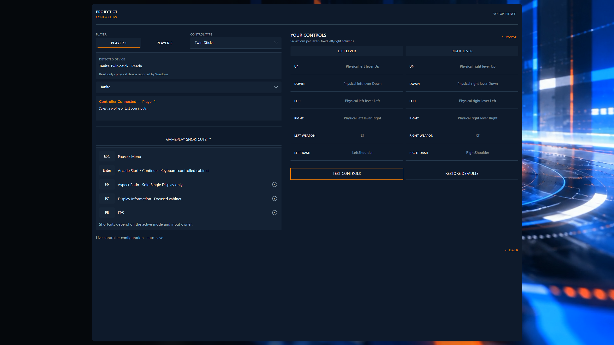

# Gamepads and arcade Twin-Sticks

Open **Settings → Controllers**. Choose **Gamepad** for Xbox, compatible PlayStation/XInput and other compatible dual-analog gamepads. Gamepads share one control type; there are no manufacturer-specific Gamepad choices.

Arcade profiles include **HORI Twin Stick EX**, **Tanita**, **Custom / Brook**, **Raphnet Dreamcast v1** and **Raphnet Saturn v2**. HORI has one visible selection. Use the matching adapter/profile and check your hardware in Test Controls; see [Known Issues](known-issues.md#controllers) for variant coverage.

## Assign a player

1. Connect from Title or Controllers. On Controllers, select Player 1 or Player 2 first.
2. Release the controls to neutral, then hold **Start for 750 ms**.
3. Release Start and **tap it again to confirm**. This tap assigns the device without activating a menu item. Another long hold does not confirm.
4. Check the connected-player message and open **Test Controls**.

Each player needs a different device. Keyboard fallback belongs to P1; Local VS needs a physical P2 controller. On each LAN station, claim the local controller as P1. Reclaim an ambiguous reconnected XInput device rather than trusting its old connection slot.

## Test and customize

Test both levers' Up, Down, Left, Right, Weapon and Dash contacts, including simultaneous inputs and release to neutral.

Use enabled binding prompts to customize controls. Fixed Twin-Stick mappings are read-only. Resolve conflicts with **Swap** or **Cancel**. Calibrate gamepad sticks one at a time; adjust dead zones and X/Y inversion separately.

Accepted binding edits auto-save. Cancel stops the active capture, not earlier edits. Where an assignment screen offers Save/Cancel, they apply to that pending selection. **Restore Defaults** affects the current control type and offers **Undo**.

A short gameplay Start press is the arcade Start input; the longer menu gesture has a different purpose.

## Returning to Title

An earlier controller-navigation report after Solo was not reproduced on physical retest. The RC preserves existing routing. If it recurs, use keyboard or mouse to open [F12 Feedback](feedback.md), and record the player assignments and claim order. Clicking or reconnecting is not an accepted correction.

Controller Settings in this capture shows a Tanita profile assigned to P1. This is not certification of every listed device or adapter.
