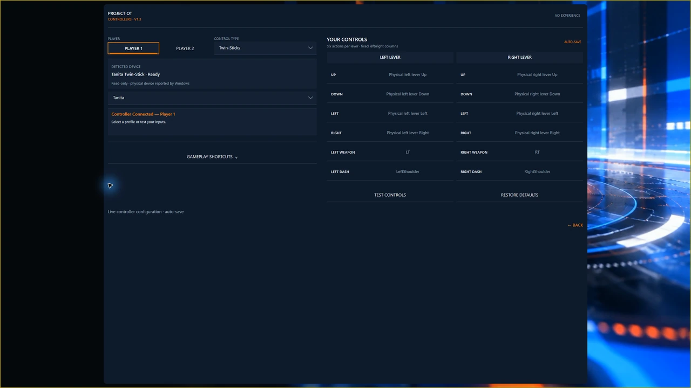
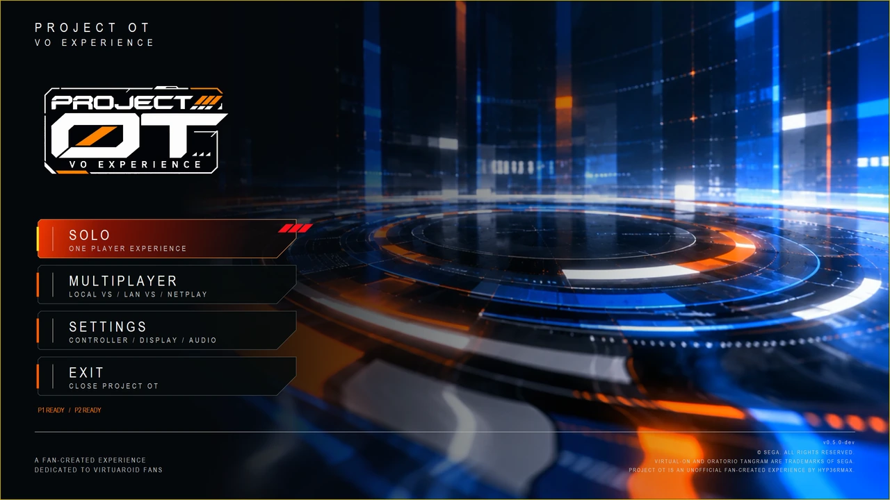

# Behind PROJECT OT
### Preserving Virtual-On: Oratorio Tangram 5.66

## Why I Started PROJECT OT

*Virtual-On: Oratorio Tangram* has always been one of those arcade games that deserves to be experienced properly.

The speed, precision, Twin-Stick controls and competition between linked cabinets made it something special. Every part of the original arcade experience worked together.

Over the years, SEGA brought *Oratorio Tangram* to different platforms, giving players more ways to experience the game. Each release has its place, but I kept coming back to the original NAOMI 5.66 version.

I wanted to see how far that original arcade release could go on modern PC hardware.

Not by rebuilding the game, changing its mechanics or combining features from different versions. The idea was to preserve the original experience while improving the technology surrounding it.

That's where PROJECT OT began.

## Starting With the Original Game

The first priority was establishing a reliable reference.

The original SEGA NAOMI M.S.B.S. Ver. 5.66 release became the foundation. Its gameplay, movement, weapons, timing and cabinet behavior would remain the standard against which improvements were measured.

The dedicated runtime builds upon existing NAOMI emulation technology, allowing the original software to execute without translating the entire game into a new Windows program.

That distinction is important.

The goal has never been to recreate *Oratorio Tangram*. The aim was to retain what SEGA originally developed and make the surrounding experience work naturally on modern hardware.

Early work focused on establishing repeatable builds, removing unnecessary runtime features and getting the original game running consistently.

Once that foundation was working, attention could turn to the parts of the experience that needed more attention.

## Bringing Twin-Sticks to Modern Hardware

Controllers were one of the first areas I wanted to get right.

The original arcade Twin-Sticks are central to how Virtual-On feels. Movement, dashing, jumping and weapon combinations all depend on how the two levers work together.

Modern dual analog gamepads provide another way to enjoy those controls, but I also wanted players with actual Twin-Stick hardware to be able to use it.

That led to support for Xbox and compatible PlayStation gamepads alongside HORI, Tanita, custom Brook-based Twin-Sticks and supported Raphnet adapters.

Different devices report their inputs differently. Some behave like gamepads, while others expose individual buttons, directional inputs or axes.

Working through those differences allowed PROJECT OT to translate compatible hardware into the original arcade controls without changing the game's underlying behavior.

Independent controller ownership was equally important. Two players should be able to connect different devices, assign them and play together without fighting over controller order.

Seeing modern gamepads and original-style Twin-Sticks working together in a linked match was one of the more satisfying milestones.

<!-- POT-MEDIA03:controller-illustration -->

*Development illustration: DEV-UAT04, November 11, 2026. This illustrates the controller work described above; it is not a capture from an earlier milestone.*
<!-- /POT-MEDIA03:controller-illustration -->

## Getting Two NAOMI Cabinets Running Together

Local VS became one of the project's biggest challenges.

The original arcade game was designed around linked cabinets. Running two copies of the game on one PC wasn't enough. Both had to communicate correctly, recognize their cabinet roles and enter the same match.

Early investigations established communication between the two running environments, but actual linked gameplay required more work.

One important breakthrough came from understanding how the original NAOMI cabinet configuration was stored and applied. Correcting the cabinet roles through the game's Test Mode and preserving those settings allowed the two environments to establish linked gameplay.

From there, the focus shifted to making the entire experience reliable.

PROJECT OT needed to start both cabinets, manage their displays and controllers, recognize when a session ended and close everything cleanly.

The result was a proper Local VS experience managed through one application.

Players can share a single display or use two independent monitors, bringing the original competitive cabinet arrangement into a modern PC setup.

## Preserving the Arcade Cabinet Experience

Standard Local VS was only part of the original arcade experience.

Dedicated arcade setups have different needs. Two cabinets may need to remain available beyond a single match, retaining their individual presentation and controls.

That led to Arcade Cabinet Mode.

Rather than treating both sides as temporary game windows, PROJECT OT supports persistent NAOMI cabinet environments designed for dedicated installations.

This gives enthusiasts another way to recreate the original linked arcade experience while keeping standard Local VS straightforward for players using a regular PC.

Both approaches share the same preservation goal, but they're designed for different ways of enjoying the game.

## Going Beyond 4:3

Modern display support became one of the project's most interesting engineering investigations.

The original NAOMI game was built around a 4:3 display. Increasing the output resolution was relatively straightforward, but achieving genuine widescreen gameplay was another matter.

Stretching the picture distorts the original presentation. Cropping the top and bottom sacrifices part of the original camera view.

The goal was to preserve the vertical framing while expanding what players could see horizontally.

That meant looking deeper into how the game and the dedicated runtime handled rendering.

The research covered PowerVR geometry, camera projection, clipping and the original game's visibility behavior.

One important discovery was that correcting the renderer alone wasn't enough.

At wider aspect ratios, some objects could fall within the expanded view but still disappear because the original game had already decided they were outside its visible area.

Those objects weren't simply being cropped by the renderer. Their geometry wasn't reaching PowerVR in the first place.

The investigation eventually identified the horizontal visibility restriction responsible for one of those cases and led to a guarded correction within our dedicated runtime.

In a controlled comparison, a previously missing group of stage geometry went from zero to 576 submitted polygons.

More importantly, the difference could be demonstrated through actual gameplay captures, with the original visibility restriction and corrected behavior running under matching rendering conditions.

That investigation helped establish the foundation for genuine 16:9, 21:9 and 32:9 horizontal expansion while preserving the original game mechanics.

It was a good reminder that widescreen compatibility involves more than changing a resolution setting.

## Making the Runtime More Efficient

Display expansion also made performance an important part of our research.

Rendering more of the game world can introduce additional work. The investigation focused on where that work occurred and whether the runtime could handle it more efficiently.

Investigations covered graphics processing, texture handling, SH-4 execution and NAOMI communication.

Some changes produced measurable improvements in specific operations. Others exposed tradeoffs, showed little benefit or were eventually rejected.

Changes that demonstrated useful results were kept, and the ones that didn't were documented.

The purpose wasn't to chase impressive benchmark numbers. It was to improve the runtime without compromising gameplay timing, rendering accuracy or the original arcade behavior.

A faster individual operation doesn't always translate into better overall gameplay. Understanding that difference has been an important part of the project.

## Bringing Multiplayer Across the Network

Once same-PC Local VS was established, the next challenge was extending linked gameplay to separate computers.

The original game depends on timely communication between its cabinets. Moving that interaction across a physical network introduced new considerations involving packet delivery, connection handling and synchronization.

The work involved investigating the existing communication behavior, developing dedicated LAN handling and testing actual linked gameplay between separate PROJECT OT stations.

Both Ethernet and wireless connections have been part of our testing.

Wired Ethernet remains our recommended setup, particularly for dedicated installations. Wi-Fi also works, although automatic discovery can depend on Windows, wireless adapter capabilities and router configuration.

The Match Board brings the multiplayer experience together by allowing players to discover available stations, challenge opponents and prepare for a match.

Direct Connect provides another option when automatic discovery isn't available.

For me, the important achievement is being able to bring the original linked competition beyond a single computer while keeping the experience accessible.

## Building the Experience Around the Game

As the runtime and multiplayer capabilities developed, another challenge became clear.

Players shouldn't have to manage separate emulator windows, manually assign cabinet roles or navigate complicated technical settings every time they want to play.

PROJECT OT needed its own identity and a straightforward way to bring everything together.

That led to the Title Menu, controller configuration, display settings, audio options and multiplayer management.

Each part serves the same purpose: make the original arcade software easier to enjoy without changing the game itself.

The interface also needed to work with gamepads and Twin-Sticks, not just a keyboard and mouse.

A dedicated arcade setup should feel natural from the moment it launches.

<!-- POT-MEDIA03:experience-illustration -->

*Development illustration: the DEV-UAT04 Experience interface, November 11, 2026.*
<!-- /POT-MEDIA03:experience-illustration -->

## What We've Learned

PROJECT OT has involved plenty of experimentation.

Some ideas worked almost immediately. Others took several attempts before we understood the actual problem. A few turned out to be more complicated than the benefit justified.

One lesson has been knowing when to stop investigating, preserve the findings and move forward.

Another has been the importance of keeping the original game as the reference.

It's easy to assume that a newer behavior is automatically better. But when you're working with arcade preservation, changes need to be understood before they're accepted.

That applies to controllers, rendering, audio, performance and multiplayer.

Keeping the work organized has also mattered. Runtime improvements, the player experience and engineering research each have their own responsibilities, making it easier to preserve working behavior while developing new capabilities.

## Where PROJECT OT Is Heading

PROJECT OT has grown from an experiment in running the original NAOMI game into a complete Windows arcade experience.

Modern gamepads and Twin-Sticks, expanded displays, Local VS, Arcade Cabinet Mode and LAN multiplayer have all become important parts of that work.

The focus now is on bringing those pieces together into a reliable release, with clear installation instructions, authentic demonstrations and the documentation players actually need.

The original goal hasn't changed.

I wanted *Virtual-On: Oratorio Tangram 5.66* to feel like the arcade game I remembered, without making modern hardware another obstacle to enjoying it.

Everything we've built around the game comes back to that.

**Preserve the game. Improve the experience.**
