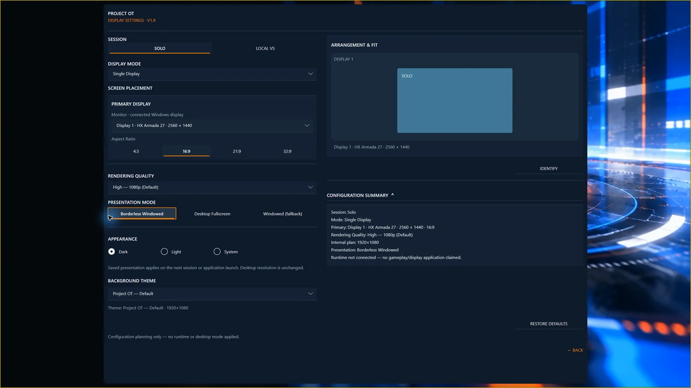
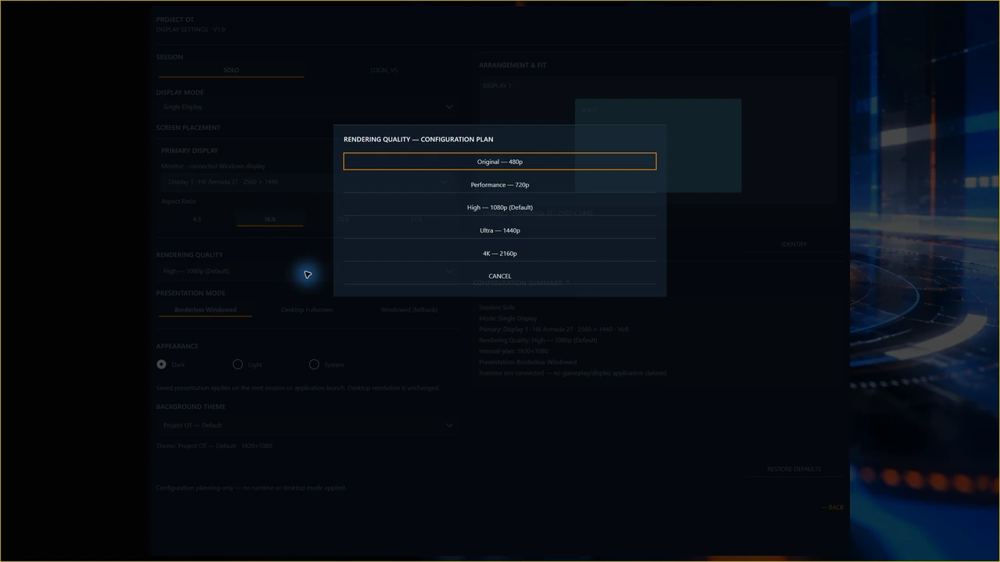
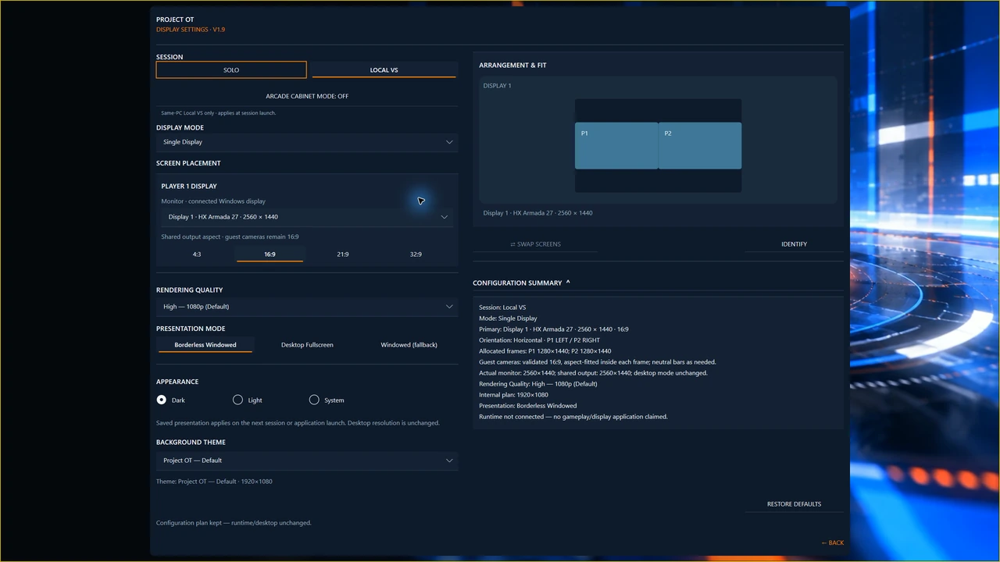
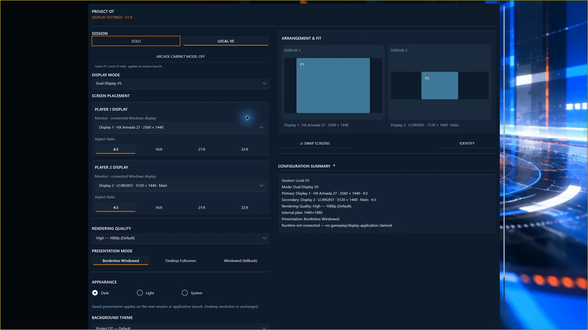

# Display settings and Hor+ widescreen

Open **Settings → Display** at Title. Choose the session, arrangement, monitors, aspect ratio and rendering quality before starting play.

## Aspect ratio and quality

Use original **4:3**, primary modern **16:9**, or supported **21:9** and **32:9** presentation. Hor+ preserves the original vertical framing while showing more world horizontally, rather than stretching the picture.

Rendering Quality offers **Original 480p**, **Performance 720p**, **High 1080p**, **Ultra 1440p** and **4K 2160p**. High is the default. Internal rendering quality is separate from Windows desktop resolution; choose a setting that runs consistently on your PC.

<!-- POT-MEDIA03:quality -->

*Configured internal resolution and Windows display resolution are separate.*

Rendering quality options

*Available quality choices; no performance comparison is implied.*

<!-- /POT-MEDIA03:quality -->

## Single Display and Dual Display VS

**Single Display** is the default for Solo and Local VS. Local VS gives both players independent views on one monitor. The established 32:9 layout is side-by-side; check [Known Issues](known-issues.md#display) for newer stacked layouts.

**Dual Display VS** gives each Local VS player a separate physical monitor. Assign both displays, use **Identify** to locate them and **Swap Screens** where offered to exchange player placement. Windows display duplication does not provide independent player views.

<!-- POT-MEDIA03:arrangements -->

*Single Display configuration. This is a settings preview, not a live two-player match.*

*Dual Display VS configuration. This is a settings preview, not a live two-monitor match.*
<!-- /POT-MEDIA03:arrangements -->

## Save and recover

Solo and Local VS keep separate preferences. Edits save automatically; changes needing confirmation show **Keep/Revert** for 15 seconds. Keep saves the plan; Revert or timeout restores the previous plan. Start a new session to use saved launch changes—confirmation does not move a running game.

Check the fallback arrangement if a saved monitor is missing. Return to Title before changing cables or desktop topology. If recovery fails, retain the message and use [Troubleshooting](troubleshooting.md); do not delete all preferences.
