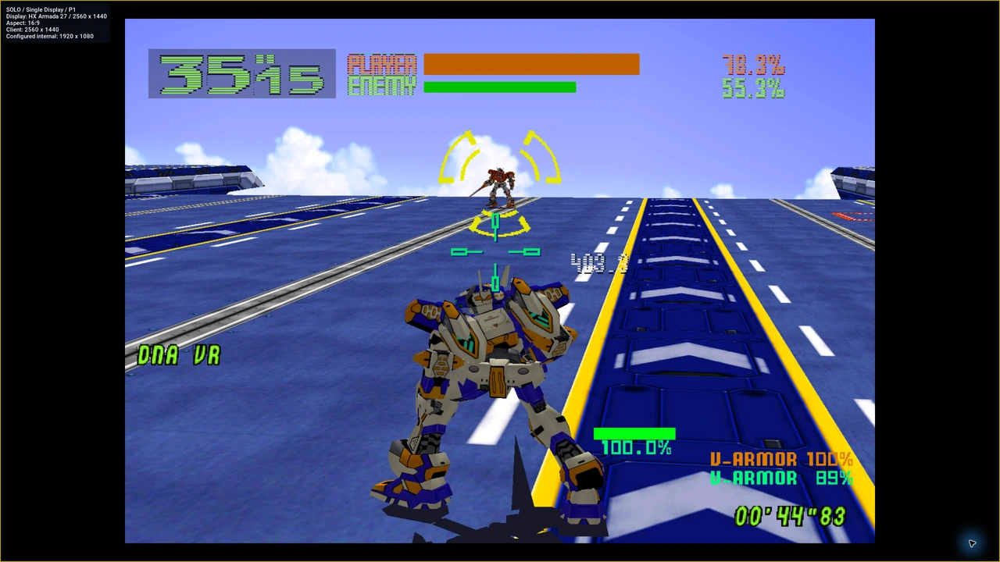
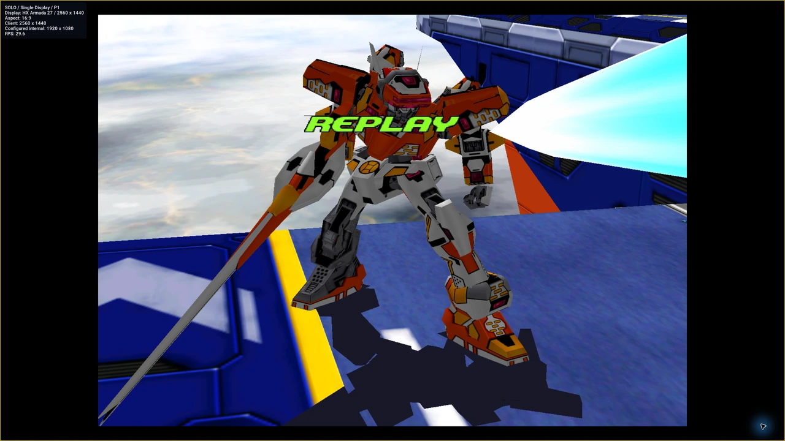

# Gameplay function keys

These bindings were checked against the captured DEV-UAT04 source and the matching DEV-UAT05 shortcut handlers. F6–F8 were observed in the physical capture session. F6–F8 apply to an active, focused game view; menu focus and session ownership matter.

| Key | Current behavior | Verification scope |
| --- | --- | --- |
| F5 | Reserved; no HUD action is enabled. | Source-verified. No HUD-disabled image is claimed. |
| F6 | Cycles supported aspect ratios in Solo Single Display. Unavailable in Local VS and LAN VS. | Observed in Solo. Changes horizontal rendering width; it does not change the Windows desktop resolution. |
| F7 | Toggles display information for the focused owned game view. | Observed during Solo combat; linked-mode operation has not been physically rechecked here. |
| F8 | Toggles the runtime FPS overlay for the focused owned game view. | Observed in Solo; the saved example below is automatic match replay, not active combat or a benchmark. |
| F12 | Opens or closes the Experience feedback panel. | Current source-verified binding; not physically rechecked in this capture session. |

*F7 during real Solo combat; original native ARMADA capture.*

*F8 during automatic replay. The instantaneous value is not a benchmark measurement.*
