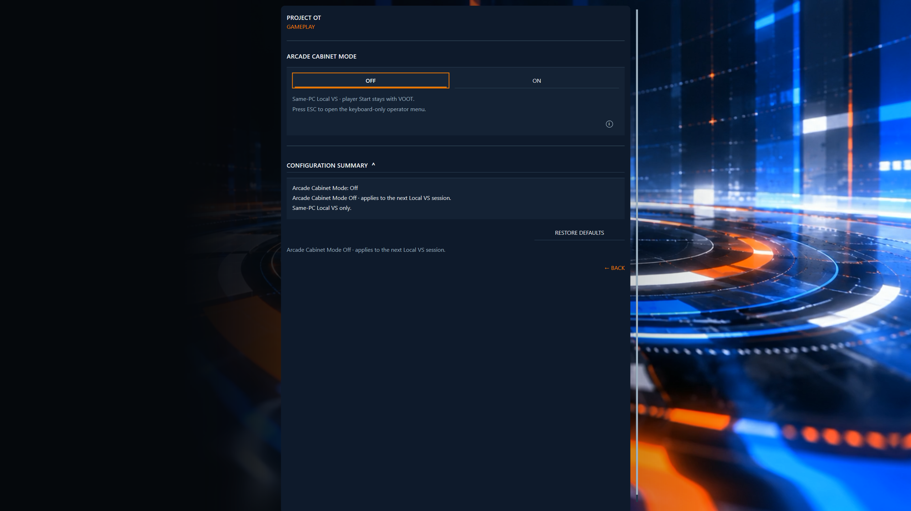

# Gameplay settings: Arcade Cabinet Mode

Open **Settings → Gameplay** for the existing Arcade Cabinet Mode settings interface. The capture shows **Off** selected; its summary applies to the next same-PC Local VS session.

This is the Arcade Cabinet Mode settings interface, not a gameplay capture. See [Local VS](local-vs.md#arcade-cabinet-mode) for the mode and session guidance. The screenshot's help text does not establish additional Pause or controller qualification.

[Player guides](README.md) · [Known issues](known-issues.md)
