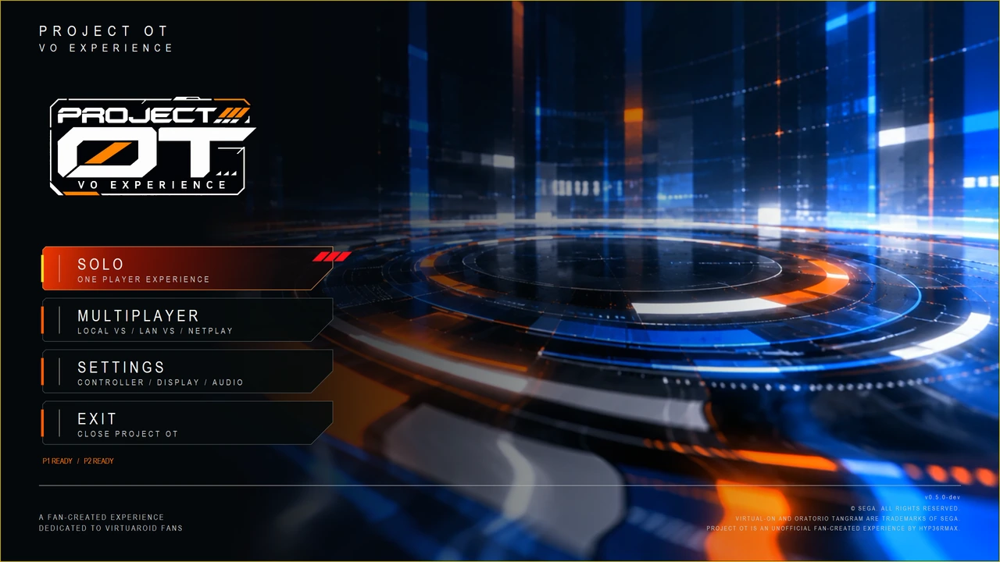

# Getting started with PROJECT OT on Windows

PROJECT OT brings the original SEGA NAOMI *Virtual-On: Oratorio Tangram M.S.B.S. Ver. 5.66* experience to a Windows x64 PC. Use a compatible gamepad or arcade Twin-Sticks. Minimum CPU, GPU, memory and storage requirements have not been published.

## Microsoft prerequisites

The current package requires [Microsoft .NET 10 Runtime x64](https://dotnet.microsoft.com/en-us/download/dotnet/10.0) and [Visual C++ Redistributable x64](https://aka.ms/vc14/vc_redist.x64.exe). Choose **.NET Runtime → Windows → x64**; the current native application does not require the .NET Desktop Runtime or SDK. The checked Visual C++ baseline is v14 14.51.36247.0 or later. Follow the final package's prerequisite list if it changes.

## Download, set up and play

The first public package is still being prepared. When available:

1. Download the approved package from [GitHub Releases](https://github.com/hyp36rmax/project-ot/releases) and follow its extraction instructions.
2. Add your authorized game and NAOMI firmware files in the location specified by that package. Current preparation uses `vonot.zip` and `naomi.zip`, with `jvs13551.zip` and `mie.zip` where required. Use the documented revisions and checksums.
3. Launch `ProjectOT.exe`.
4. Open **Settings** to [claim and test your controller](controllers.md), choose [Display](display.md) and review [Audio](audio.md).
5. Choose [Solo](solo.md), **Multiplayer → Local VS**, or **Multiplayer → Link Play → LAN VS**.

<!-- POT-MEDIA03:title -->

*Title Menu from the captured DEV-UAT04 build.*
<!-- /POT-MEDIA03:title -->

Use the mode guide to end the session, then return to Title and confirm **Exit**. Keep previous installations and saves separate until upgrade instructions are available.

No game or firmware downloads are supplied. For startup errors, see [Troubleshooting](troubleshooting.md); final installation paths and migration steps remain package-dependent.
