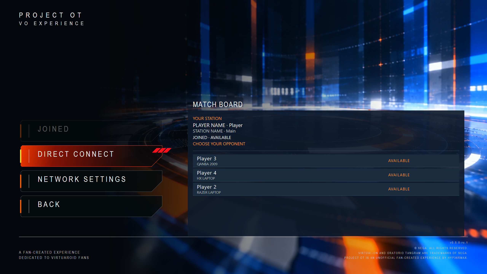

# LAN VS over Ethernet or Wi-Fi

Use matching PROJECT OT packages and authorized game/firmware data on both stations. Claim the local controller as **Player 1 on each PC**, then configure its display and audio.

**Wired Ethernet is recommended. Wi-Fi is supported.** Automatic discovery depends on Windows settings, active adapters, wireless capabilities, router settings and whether connected devices may communicate. Stations can be on the same network without appearing automatically.

## Candidate qualification

### Physically Validated LAN Gameplay

PROJECT OT's LAN implementation has been physically tested across seven different PC setups for station discovery. Multiple cross-PC matches were completed over Ethernet and Wi-Fi, including extended gameplay sessions.

Automatic discovery, Match Board challenge/acceptance/readiness, and LAN controller ownership/focus were physically exercised; the controller/focus acceptance was **9/9 physical PASS**. Seven is the corrected count of different discovery setups, not simultaneously connected PCs, every possible pair/role assignment, or a claim that each setup completed every gameplay test.

An intermittent `NETWORK ERROR` / `0xB002`, a previously observed Wi-Fi dropout, reversed-role testing and repeated reconnect/failure recovery remain open. Wired Ethernet is recommended. The accepted Ethernet session that ended intentionally was not a confirmed transport failure. Windows authorization and adapter/router-dependent discovery still matter.

This development history is retained; it is not a repeated full physical cycle on the exact final corrected RC or a promise of universal reliability. See [validation history](validation-history.md).

## Match Board

1. Open **Multiplayer → Link Play → LAN VS**. Discovery starts on entry.
2. Select **Join** to make your station available for invitations.
3. Select an available opponent. A mouse click highlights; double-click, keyboard Enter or controller Confirm challenges. Selecting an opponent also joins the board if needed.
4. The other player chooses **Accept**, then both choose **Ready**.

Busy or incompatible stations cannot be challenged. Expired entries disappear. Set neutral **Player Name** and **Station Name** through Network Settings, available from the board and **Title → Settings → Network**. Both routes edit the same saved values.

## Direct Connect

If discovery misses the other station, use Direct Connect where available. One PC selects **Host** and leaves the waiting screen open. On the other, choose **IP**, enter the host's local address, **Save**, then **Join**. The host still accepts and both players choose Ready.

## Finish a session

Linked gameplay can continue while the Experience menu is open. Confirm **Return to Title** to stop the match; the Match Board workflow returns there after cleanup. Use Back to leave the board, then confirm Exit at Title.

For an empty board or inconsistent wireless connection, follow [Troubleshooting](troubleshooting.md#lan-stations-cannot-connect). Direct Connect does not bypass compatibility or Windows permissions. See [Windows network access](network-access.md). Current package limits are in [Known Issues](known-issues.md#lan-vs).

The Match Board capture shows three available stations and Direct Connect. That image does not limit the separate seven-setup discovery history or represent seven simultaneous PCs. Physical LAN matches are documented above; Internet NETPLAY VS remains unavailable.
