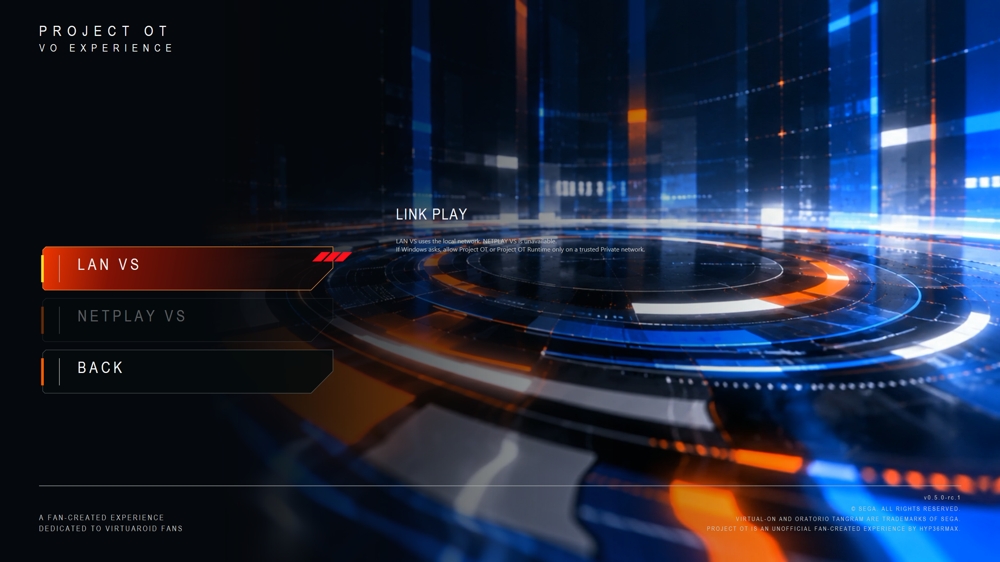

# Link Play menu

Open **Multiplayer → Link Play**. Choose **LAN VS** for local-network play, or **Back** to return. **NETPLAY VS is unavailable**.

LAN VS uses your local network. If Windows asks, allow Project OT or Project OT Runtime only on a trusted Private network. Direct Connect does not bypass Windows permissions or opponent consent.

See [LAN VS](lan-vs.md) for the Match Board, challenge, acceptance, readiness and Direct Connect workflow, and [Windows network access](network-access.md) for authorization limits. The menu is not evidence of public internet matchmaking or sustained LAN gameplay acceptance.

[Multiplayer menu](multiplayer.md) · [Player guides](README.md)
