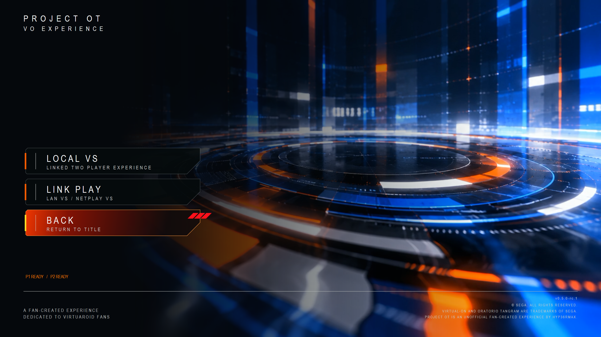

# Multiplayer menu

Choose **Multiplayer** at Title. **Local VS** opens the same-PC two-player experience. **Link Play** leads to the linked-play menu. **Back** returns to Title.

The capture shows the existing menu and P1/P2 readiness indicators. For setup and qualification limits, use the [Local VS guide](local-vs.md) or [Link Play guide](link-play.md).

[Player guides](README.md) · [Known issues](known-issues.md)
