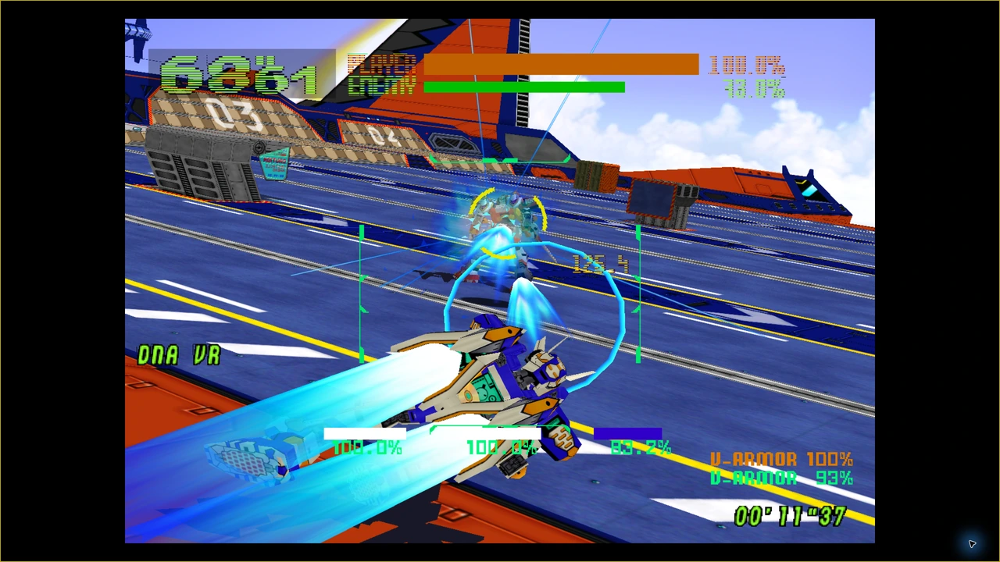

# Solo gameplay

Solo runs the original *Virtual-On: Oratorio Tangram M.S.B.S. Ver. 5.66* arcade game for one player.

## Start playing

1. At Title, open **Settings → Controllers** and [claim and test Player 1](controllers.md). A compatible controller or P1 keyboard fallback can be used.
2. Review [Display](display.md) and [Audio](audio.md).
3. Return to Title and choose **Solo**.
4. Once the game is active, use a short **Start** press to enter the arcade game's flow. Keyboard Enter supplies the arcade Start input.

Keep the short arcade Start input separate from the controller's longer menu gesture. Follow the game's own prompts as you play.

<!-- POT-MEDIA03:combat -->

*Solo combat · configured 1920×1080 internal rendering; original 2560×1440 ARMADA capture.*
<!-- /POT-MEDIA03:combat -->

<!-- POT-MEDIA03:function-link -->
[Verified gameplay function keys](functions.md) describe the current F5–F8 behavior and capture evidence.
<!-- /POT-MEDIA03:function-link -->

## Open the menu or leave

Keyboard **ESC** opens the Experience menu. Use **Resume** to return to the same session, **Controllers** to adjust assignment, or **Return to Title** to finish. Release held inputs before resuming.

Read the displayed status to see whether gameplay is paused or continues behind the menu. Opening a menu alone is not a pause guarantee.

Return to Title asks for confirmation, with **Stay** selected first. Stay keeps the session; confirming Return to Title ends it. At Title, choose **Exit** and confirm to close PROJECT OT.

If startup or shutdown stalls, keep the visible message and use [Troubleshooting](troubleshooting.md) before launching another copy.
